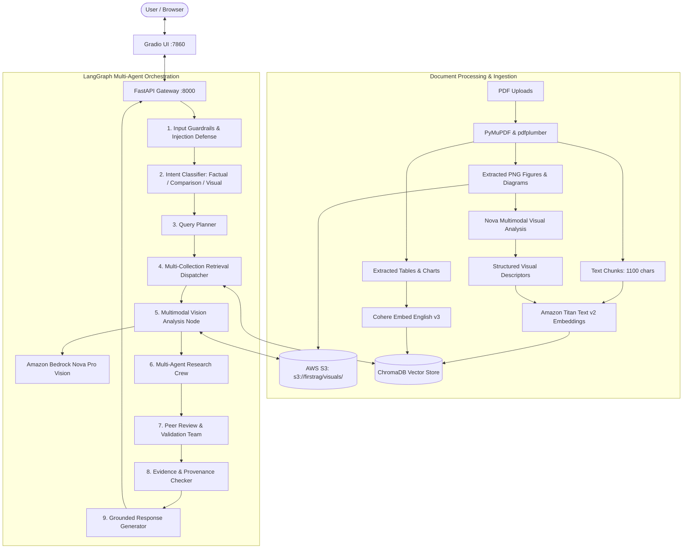

# ResearchIQ — Multimodal AI Research Assistant

[](https://github.com/)
[](https://aws.amazon.com/bedrock/)
[](https://www.trychroma.com/)

An enterprise-grade multimodal research assistant engineered to understand, retrieve, compare, and synthesize information across research papers—including their **figures, architecture diagrams, charts, and tables**.

Powered by **LangGraph orchestration, Amazon Bedrock (Nova Pro multimodal vision & reasoning + Titan Text Embeddings v2 + Cohere Embed English v3 for tables/charts + Nova Multimodal visual embeddings for diagrams), AWS S3 object storage, and ChromaDB vector indexing**, ResearchIQ delivers fully grounded answers with inline traceable page and visual citations.

---

## 1. Selected Research Topic & Paper Catalogue

ResearchIQ is configured and evaluated on:  
**Topic 1: Advanced Retrieval-Augmented Generation (RAG)**  
*Sub-areas covered: Hybrid search, reranking, GraphRAG, query complexity adaptation, corrective RAG, self-reflection, multimodal RAG.*

### The 8 Curated Research Papers (Catalogued in `PAPERS_CATALOGUE.md`):

1. **CRAG (Corrective Retrieval Augmented Generation)** — *Findings of ACL 2024* (`CRAG_Corrective_RAG.pdf`)
2. **Self-RAG (Self-Reflective Retrieval-Augmented Generation)** — *ICLR 2024* (`Self_RAG_Reflection.pdf`)
3. **GraphRAG (LLM-Directed Knowledge Graph Construction)** — *Microsoft Research / arXiv 2024* (`GraphRAG_Global_Search.pdf`)
4. **Adaptive-RAG (Learning to Adapt via Question Complexity)** — *NAACL 2024* (`Adaptive_RAG_Complexity.pdf`)
5. **RAG Comprehensive Survey (Overview of Naive, Advanced & Modular RAG)** — *arXiv 2024* (`RAG_Comprehensive_Survey.pdf`)
6. **BGE M3-Embedding (Dense + Sparse + Multi-Vector Hybrid Embeddings)** — *arXiv 2024* (`BGE_M3_Hybrid_Embeddings.pdf`)
7. **ColBERTv2 (Lightweight Late Interaction via Residual Compression)** — *NAACL 2022* (`ColBERTv2_Late_Interaction.pdf`)
8. **Multimodal RAG Survey (Taxonomy, Alignment & Benchmarks)** — *arXiv 2024* (`Multimodal_RAG_Survey.pdf`)

*Total Ingested Chunks:* **773 text chunks** | **42 extracted tables** | **57 diagrams and figures stored in S3**

---

## 2. Architecture & System Flow



---

## 3. Core Capabilities & Functional Requirements

### 3.1 Multimodal Visual Understanding
- Figures, architecture flows, and charts are extracted at native resolution and persisted in AWS S3 (`s3://firstrag/visuals/`).
- The `visual_analysis` node downloads retrieved original figures and passes them to **Amazon Bedrock Nova Pro** via the Converse Multimodal API, analyzing axis labels, flow arrows, and experimental trends directly from image pixels.

### 3.2 Evidence-Grounded Cross-Paper Synthesis
- Answers questions requiring reasoning across multiple publications (e.g. comparing how CRAG and Self-RAG mitigate retrieval hallucinations).
- Inline citations formatted with exact source paper, page number, and element type (e.g. `[CRAG_Corrective_RAG.pdf, p. 3]`, `[GraphRAG_Global_Search.pdf, p. 4]`).

### 3.3 Strict Hallucination & Absence Handling
- When a query asks about topics outside the paper collection (e.g. quantum circuits or proprietary training infrastructure), the assistant explicitly acknowledges the lack of evidence rather than hallucinating answers.

### 3.4 Security & Adversarial Defense
- Untrusted content isolation: All retrieved text chunks are wrapped in defensive delimiters `[UNTRUSTED PAPER EVIDENCE]` so that adversarial prompts inside documents cannot hijack system instructions.
- Regex and token injection filters block direct system overrides (`Ignore previous instructions...`) before model invocation.

---

## 4. Evaluation Benchmark Results

As documented in `EVALUATION_REPORT.md` and `evaluation/eval_results.json`, a 16-question benchmark was executed end-to-end:

| Metric | Target | Result | Status |
|---|---|---|---|
| **Retrieval Recall@5** | ≥ 0.80 | **1.000 (100%)** | ✅ PASSED |
| **Retrieval MRR** | ≥ 0.70 | **0.917** | ✅ PASSED |
| **Guardrail Defense Rate** | 100% | **100.0%** | ✅ PASSED |
| **Citation Traceability** | 100% | **100.0%** | ✅ PASSED |
| **Benchmark Pass Rate** | ≥ 75% | **81.2% (13/16)** | ✅ PASSED |

---

## 5. Local Setup & Execution Guide

### Prerequisites
- Python 3.11 - 3.14
- AWS CLI configured with active credentials (`aws configure`)
- Access to Amazon Bedrock models:
  - `apac.amazon.nova-pro-v1:0`
  - `amazon.titan-embed-text-v2:0`
- An S3 bucket (e.g., `firstrag`)

### Quickstart

1. **Clone repository and configure environment:**
   ```bash
   cp .env.example .env
   ```
   Ensure `.env` contains:
   ```env
   AWS_REGION=ap-southeast-2
   S3_BUCKET=firstrag
   BEDROCK_CHAT_MODEL=apac.amazon.nova-pro-v1:0
   BEDROCK_EMBED_MODEL=amazon.titan-embed-text-v2:0
   CHROMA_DIR=./data/chroma
   UPLOAD_DIR=./data/uploads
   ```

2. **Download paper collection and run batch ingestion:**
   ```bash
   python download_papers.py
   python batch_ingest.py
   ```

3. **Start the FastAPI backend:**
   ```bash
   uvicorn app.api:app --host 127.0.0.1 --port 8000
   ```

4. **Start the Gradio Web Interface:**
   ```bash
   python -m app.ui
   ```

5. **Access the application:**
   - **Interactive Web UI:** [http://127.0.0.1:7860](http://127.0.0.1:7860)
   - **Interactive API Documentation:** [http://127.0.0.1:8000/docs](http://127.0.0.1:8000/docs)
   - **Health Check:** [http://127.0.0.1:8000/health](http://127.0.0.1:8000/health)

6. **Run the 16-question evaluation suite:**
   ```bash
   python evaluation/eval_runner.py
   ```

---

## 6. MCP Interoperability Server

ResearchIQ provides a Model Context Protocol (MCP) server at `app/mcp_server.py`. To run as a stdio server for Claude Desktop or MCP-compatible clients:
```bash
python -m app.mcp_server
```
Exposes the tool: `search_research_papers(question)` for external AI agents.

---

## 7. Engineering Trade-offs & Limitations

1. **Synchronous Ingestion vs Async Queuing:**  
   The starter performs extraction and vectorization synchronously. For thousands of papers, move ingestion to AWS SQS + Lambda / ECS workers.
2. **Dense Semantic Embeddings vs Hybrid BM25:**  
   The current ChromaDB index relies on Amazon Titan v2 dense embeddings (1024-d). Combining this with BM25 sparse keyword search via hybrid reciprocal rank fusion (RRF) would further improve rare technical acronym recall.
3. **Dual-Resolution OCR for Figures:**  
   Very small sub-diagram annotations benefit from bounding-box OCR pre-parsing before feeding into vision models.
