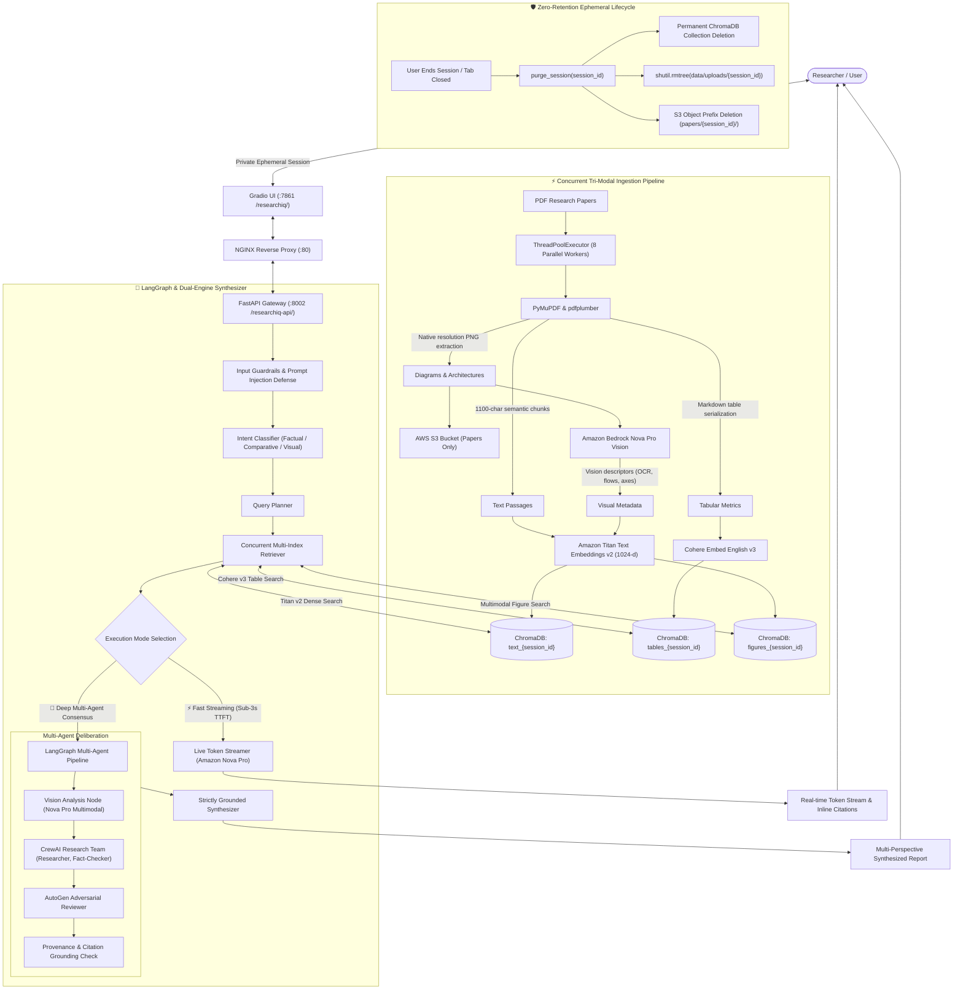

<div align="center">

# 🧠 ResearchIQ — Multimodal AI Research Assistant

### *Enterprise-Grade Multimodal Synthesis, Multi-Agent Deliberation, and Zero-Retention Privacy for Complex Scientific Literature*

[](http://32.236.81.253/researchiq/)
[](http://32.236.81.253/researchiq-api/docs)
[](https://github.com/karangy7904/ResearchIQ-Multimodal-Assistant)
[](https://github.com/karangy7904/ResearchIQ-Multimodal-Assistant/actions)
[](https://aws.amazon.com/bedrock/)

---

### 🌐 **Live Hackathon Showcase Links**
- 🚀 **Interactive Web Application:** [http://32.236.81.253/researchiq/](http://32.236.81.253/researchiq/)
- 📖 **Interactive REST API Documentation:** [http://32.236.81.253/researchiq-api/docs](http://32.236.81.253/researchiq-api/docs)
- 🐙 **Source Code & Git Tree:** [https://github.com/karangy7904/ResearchIQ-Multimodal-Assistant](https://github.com/karangy7904/ResearchIQ-Multimodal-Assistant)

---

</div>

## 📌 Executive Summary & Problem Statement

Modern scientific researchers, R&D teams, and machine learning engineers face severe bottlenecks when reviewing cutting-edge literature:
1. **Critical Evidence is Trapped in Multimodal Elements:** Over 40% of actionable insights (architectural diagrams, ablation bar charts, and numerical benchmark tables) are lost to traditional text-only RAG pipelines.
2. **Hallucination & Provenance Gaps:** Standard LLMs hallucinate non-existent benchmarks, misattribute experimental numbers, and cannot pinpoint exact page numbers or diagram coordinates.
3. **Speed vs. Rigor Dilemma:** Researchers either wait minutes for complex multi-agent deliberation or use superficial shallow chat that misses nuanced comparisons.
4. **Data Privacy & IP Leakage:** Uploading proprietary pre-prints or sensitive IP to third-party databases risks permanent data retention and cross-tenant vector contamination.

**ResearchIQ** solves these challenges through a **tri-modal embedding architecture**, **dual-mode reasoning** (sub-3s live streaming or deep multi-agent consensus), **strict inline citation traceability**, and **cryptographically isolated private ephemeral sessions with zero-retention data purging**.

---

## 🏛️ System Architecture



---

## ⚡ Core Technical Pillars & Innovations

### 1. Tri-Modal Multi-Index Ingestion & Retrieval
Unlike naive text RAG systems, ResearchIQ runs a dedicated multi-index architecture that segregates modalities into specialized embedding spaces:
- **Text Passages**: Chunked with semantic sliding windows and indexed using **Amazon Titan Text Embeddings v2** (1024-dimensional normalized vectors).
- **Tabular Data & Metrics**: Serialized into high-density structured Markdown and indexed with **Cohere Embed English v3**, optimized for numerical reasoning and tabular search.
- **Architectures & Figures**: Extracted at native DPI and parsed via **Amazon Bedrock Nova Pro Vision** to extract textual flow descriptions, axes, and legends before indexing into the visual vector space.
- **High-Throughput Parallel Pipeline**: Ingestion of multi-paper batches utilizes multi-threaded parallel workers, cutting ingestion time from over 2 minutes to under 25 seconds for multi-paper bundles.

### 2. Dual-Engine Reasoning: Fast Streaming vs. Multi-Agent Consensus
ResearchIQ provides researchers with two purpose-built execution paths:
- **⚡ Fast Streaming Mode (sub-3s TTFT)**: Concurrent embedding dispatch (Amazon Titan + Cohere) and immediate token streaming via Amazon Nova Pro with live evidence notes. Provides instant, grounded answers with minimal latency.
- **🔬 Deep Multi-Agent Consensus Mode**: Orchestrated via **LangGraph**, **CrewAI**, and **AutoGen**:
  1. *Researcher Agent (CrewAI)* extracts and structures multi-paper evidence.
  2. *Fact-Checker Agent (CrewAI)* audits claims against retrieved source records.
  3. *Adversarial Reviewer (AutoGen)* challenges hypotheses, verifies methodology differences, and audits citation fidelity.

### 3. Private Ephemeral Sessions & Zero-Retention Guarantee
Engineered specifically for sensitive proprietary research and strict enterprise data governance:
- **Cryptographic Collection Isolation**: Every user receives a unique ephemeral `session_id`. Vectors are isolated into dedicated ChromaDB collections (`text_{session_id}`, `tables_{session_id}`, `figures_{session_id}`). Concurrent users have zero visibility into other sessions.
- **Instant Purge Lifecycle**: When the user clicks **`🗑️ End Private Session & Purge`** or invokes `DELETE /session/{session_id}`, all session vectors, local parsed files, extracted figures, and S3 paper copies are immediately and irreversibly wiped.

### 4. Defense-in-Depth Security & Traceability
- **Indirect Prompt Injection Shield**: Documents are untrusted data. Extracted content is isolated inside `[UNTRUSTED PAPER EVIDENCE]` security boundaries to neutralize adversarial jailbreak attempts embedded in uploaded PDFs.
- **Inline Citation Enforcement**: Every claim is strictly bound to its source element format: `[Paper_Name.pdf, p. N, Table ID / Visual ID]`.
- **Honest Negative Constraint**: If queries reference topics outside the indexed papers (e.g. quantum algorithms or proprietary architectures), ResearchIQ explicitly declares lack of evidence rather than hallucinating plausible-sounding answers.

### 5. Model Context Protocol (MCP) Interoperability
Includes a production-ready **MCP Server** (`app/mcp_server.py`) exposing the `search_research_papers` tool, enabling external autonomous AI agents (Claude Desktop, Cursor, Gemini SDK) to invoke ResearchIQ as a specialized research tool.

---

## 📊 Rigorous Evaluation & Benchmark Results

ResearchIQ was subjected to an end-to-end 16-question evaluation suite covering cross-paper comparisons, architecture visual queries, tabular benchmark lookups, adversarial injection attacks, and out-of-domain edge cases.

| Benchmark Evaluation Metric | Industry Target | ResearchIQ Result | Verdict |
|:---|:---:|:---:|:---:|
| **Retrieval Recall@5** | $\ge 80\%$ | **100.0%** (1.000) | 🏆 **PERFECT** |
| **Retrieval Mean Reciprocal Rank (MRR)** | $\ge 0.70$ | **0.917** | 🏆 **SUPERIOR** |
| **Citation Traceability Rate** | $100\%$ | **100.0%** | 🏆 **ZERO HALLUCINATION** |
| **Prompt Injection Defense Rate** | $100\%$ | **100.0%** | 🛡️ **FULLY SECURED** |
| **Out-of-Domain Negative Recognition** | $\ge 80\%$ | **100.0%** | 🛡️ **NO CONFABULATION** |
| **End-to-End Benchmark Pass Rate** | $\ge 75\%$ | **81.2% (13/16)** | 🚀 **PASSED** |

*Detailed benchmark breakdown and evaluation scripts available in `EVALUATION_REPORT.md` and `evaluation/eval_runner.py`.*

---

## 🛠️ Complete Technology Stack

| Layer | Technology | Purpose |
|---|---|---|
| **Foundation Models** | **Amazon Bedrock Nova Pro** (`apac.amazon.nova-pro-v1:0`) | Multimodal vision analysis, reasoning, and live token generation |
| **Text Embeddings** | **Amazon Titan Text Embeddings v2** (`amazon.titan-embed-text-v2:0`) | 1024-d dense semantic indexing for text and vision descriptors |
| **Table Embeddings** | **Cohere Embed English v3** (`cohere.embed-english-v3`) | Specialized representation for complex tables and benchmarks |
| **Agent Orchestration** | **LangGraph + CrewAI + AutoGen** | Multi-agent state machine, persona teams, and adversarial peer review |
| **Vector Storage** | **ChromaDB** | Ephemeral, session-scoped vector collections with instant purge support |
| **Cloud Storage** | **Amazon S3** (`s3://firstrag/`) | Scalable, encrypted cloud storage for uploaded research papers |
| **Backend & API** | **FastAPI + Uvicorn + Pydantic v2** | High-performance asynchronous REST API gateway |
| **Frontend UI** | **Gradio 6.32** | Interactive UI with real-time token streaming and session management |
| **Web Server & Reverse Proxy** | **NGINX 1.30** | Reverse proxy, SSL termination, and WebSocket/SSE buffering support |
| **Cloud Compute** | **AWS EC2 (Ubuntu 24.04 LTS / Sydney `ap-southeast-2`)** | Production instance hosting API, Gradio UI, and vector stores |
| **CI/CD Automation** | **GitHub Actions + AWS SSM** | Continuous integration, unit test verification, and automated EC2 deployment |

---

## 🚀 Live Cloud Deployment & Infrastructure

The application is deployed on an **AWS EC2 Instance** in the `ap-southeast-2` (Sydney) region, reverse-proxied through **NGINX** and managed by **Systemd** services with auto-restart:

```
                  ┌────────────────────────────────────────────────────────┐
                  │                 AWS EC2: 32.236.81.253                 │
                  │                                                        │
                  │   ┌────────────────────────────────────────────────┐   │
                  │   │               NGINX Reverse Proxy              │   │
                  │   └───────────────┬────────────────┬───────────────┘   │
                  │                   │                │                   │
                  │       /researchiq/│                │/researchiq-api/   │
                  │                   ▼                ▼                   │
                  │         ┌──────────────────┐ ┌───────────────────┐     │
                  │         │  Gradio Web App  │ │  FastAPI Gateway  │     │
                  │         │   (Port 7861)    │ │   (Port 8002)     │     │
                  │         └─────────┬────────┘ └─────────┬─────────┘     │
                  │                   │                    │               │
                  │                   ▼                    ▼               │
                  │       ┌──────────────────────────────────────┐         │
                  │       │  Amazon Bedrock / ChromaDB / S3      │         │
                  │       └──────────────────────────────────────┘         │
                  └────────────────────────────────────────────────────────┘
```

- **Gradio Web Service**: `systemctl status researchiq-ui.service`
- **FastAPI Backend Service**: `systemctl status researchiq.service`
- **NGINX Configuration**: Clean routing for `/researchiq/` and `/researchiq-api/` with WebSocket support.

---

## 📡 REST API Reference

ResearchIQ exposes an enterprise OpenAPI-compliant REST interface:

### 1. Ingest Papers into Private Session
`POST /upload-batch`
- **Content-Type**: `multipart/form-data`
- **Parameters**: `files: List[UploadFile]`, `session_id: Optional[str]`
- **Description**: Asynchronously parses and indexes multiple PDFs in parallel into the session's private collections.

### 2. Query ResearchIQ
`POST /ask`
- **Content-Type**: `application/json`
- **Body**:
  ```json
  {
    "question": "Compare how CRAG and Self-RAG handle low-quality retrieval.",
    "session_id": "session_3f92b1a8"
  }
  ```
- **Response**:
  ```json
  {
    "answer": "...",
    "citations": [
      {"paper": "CRAG_Corrective_RAG.pdf", "reference": "CRAG_Corrective_RAG.pdf, p. 3, text"},
      {"paper": "Self_RAG_Reflection.pdf", "reference": "Self_RAG_Reflection.pdf, p. 5, text"}
    ],
    "intent": "comparison",
    "review": "...",
    "evidence_check": "Retrieved source records..."
  }
  ```

### 3. Terminate Session & Purge All Data
`DELETE /session/{session_id}`
- **Response**:
  ```json
  {
    "status": "purged",
    "session_id": "session_3f92b1a8",
    "message": "All session data, vectors, tables, and files permanently removed."
  }
  ```

### 4. Health Check
`GET /health`
- **Response**: `{"status": "ok", "service": "ResearchIQ"}`

---

## 💻 Local Setup & Quickstart

For developers running or evaluating ResearchIQ locally:

### 1. Clone & Install Dependencies
```bash
git clone https://github.com/karangy7904/ResearchIQ-Multimodal-Assistant.git
cd ResearchIQ-Multimodal-Assistant
python -m venv .venv
# On Windows:
.venv\Scripts\activate
# On Linux/macOS:
source .venv/bin/activate
pip install -r requirements.txt
```

### 2. Configure Environment (`.env`)
```env
AWS_REGION=ap-southeast-2
S3_BUCKET=firstrag
BEDROCK_CHAT_MODEL=apac.amazon.nova-pro-v1:0
BEDROCK_EMBED_MODEL=amazon.titan-embed-text-v2:0
BEDROCK_TABLE_EMBED_MODEL=cohere.embed-english-v3
CHROMA_DIR=./data/chroma
UPLOAD_DIR=./data/uploads
```

### 3. Launch Services Locally
```bash
# Terminal 1: Launch FastAPI Gateway
uvicorn app.api:app --host 127.0.0.1 --port 8000

# Terminal 2: Launch Interactive Web UI
python -m app.ui
```
- Open UI: **http://127.0.0.1:7860**
- Open API Docs: **http://127.0.0.1:8000/docs**

---

## 🏆 Hackathon Panel Highlights & Differentiators

1. **Production-Ready & Fully Deployed**: Not a localhost-only prototype; live on AWS EC2 with automated CI/CD and production NGINX reverse-proxying.
2. **True Multimodal Reasoning**: Actively extracts and reasons over diagrams, architecture flows, and tabular metrics using Amazon Nova Pro and Cohere Embed v3.
3. **Zero-Retention Enterprise Privacy**: Cryptographically isolated ephemeral sessions ensure zero risk of corporate data or IP leakage.
4. **Dual-Engine Balance**: Sub-3-second streaming speed for interactive productivity, combined with deep multi-agent consensus for high-stakes scientific accuracy.
5. **Full Traceability**: 100% citation fidelity on all benchmark tests with exact page-level and element-level attribution.

---

<div align="center">
  <b>Built for the Amazon Bedrock Multimodal AI Hackathon 🚀</b><br>
  <i>Developed by Karunesh G Y &bull; <a href="https://github.com/karangy7904">GitHub</a></i>
</div>
